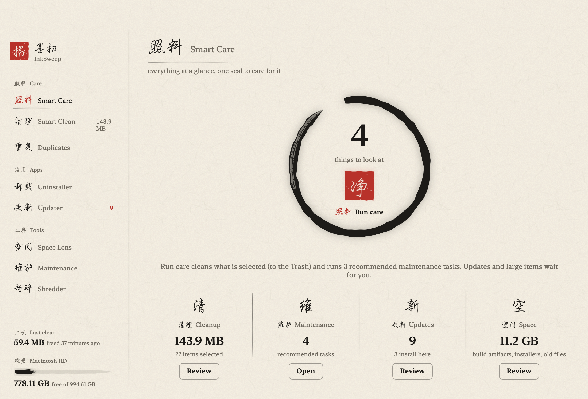
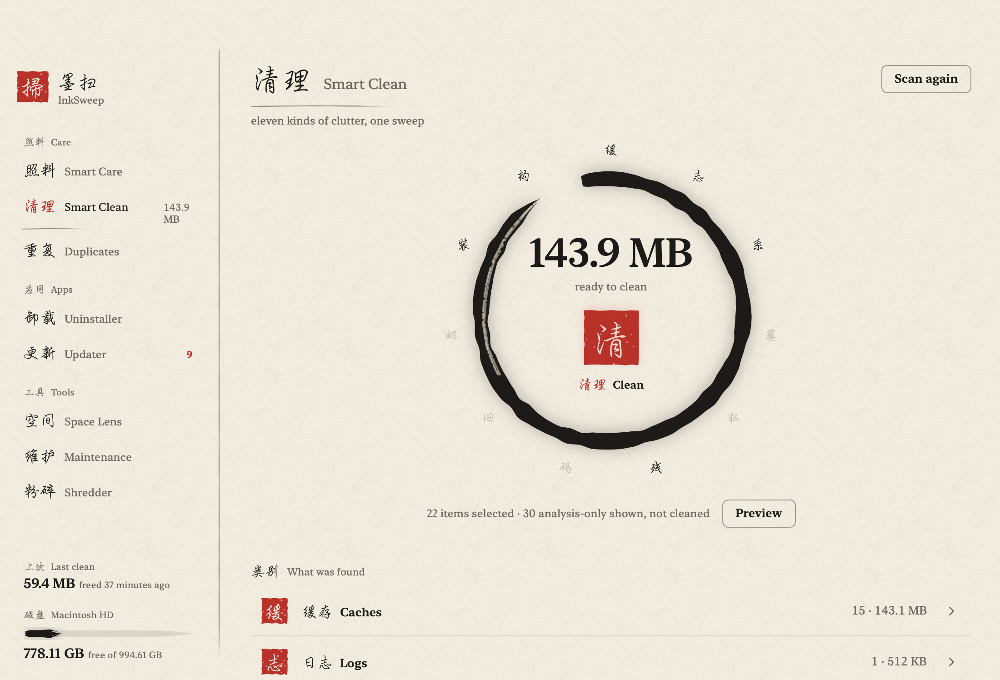
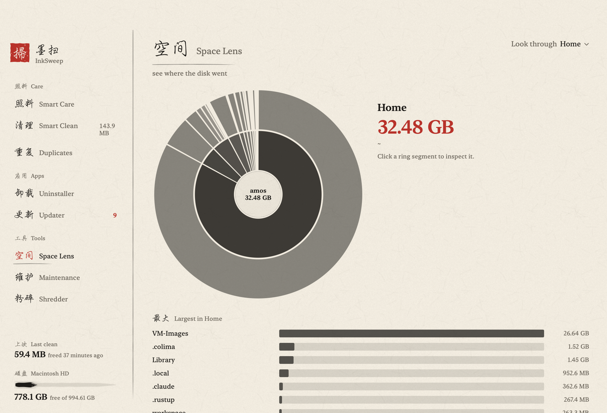
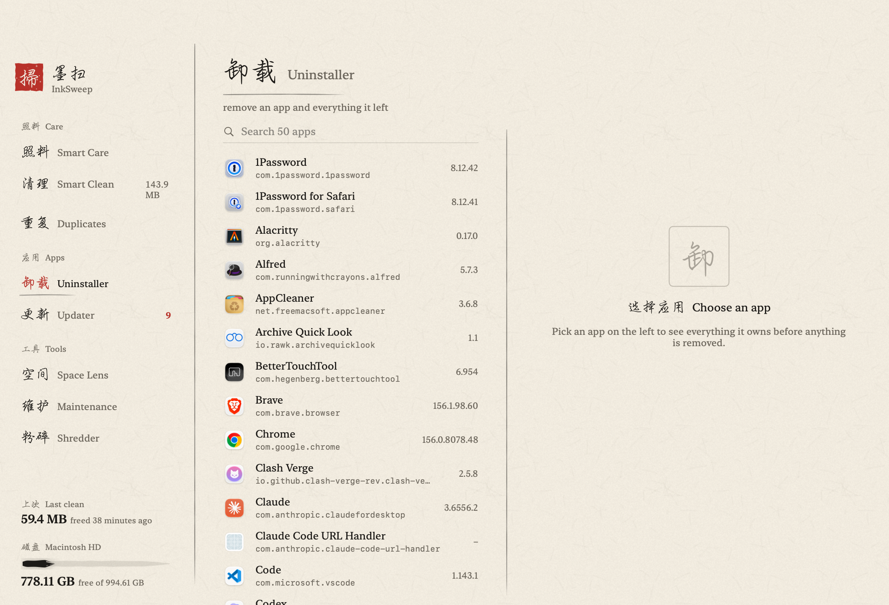
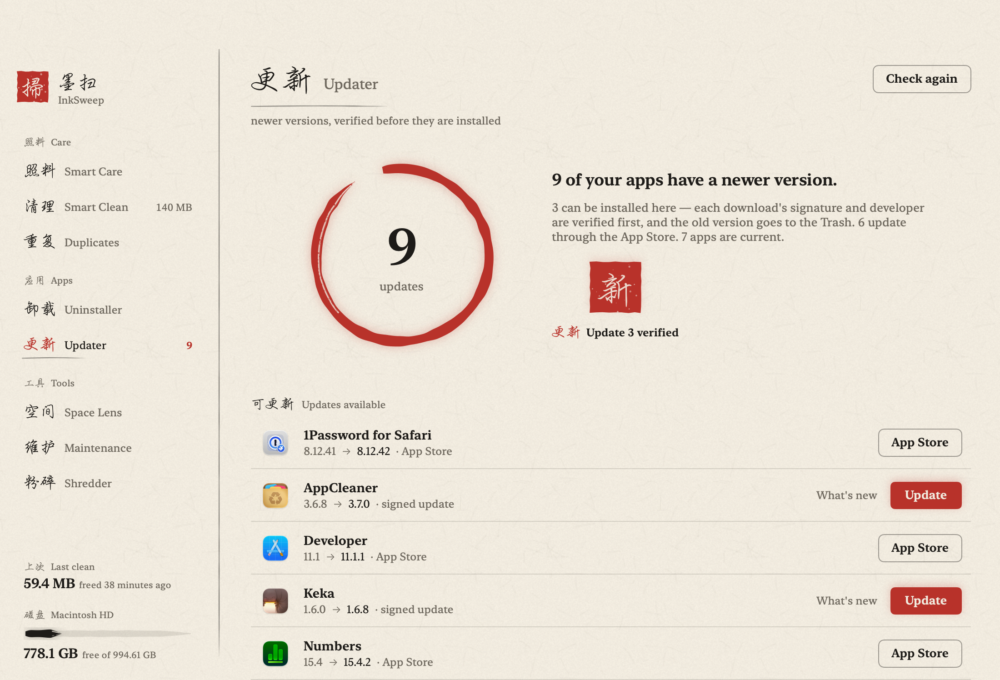
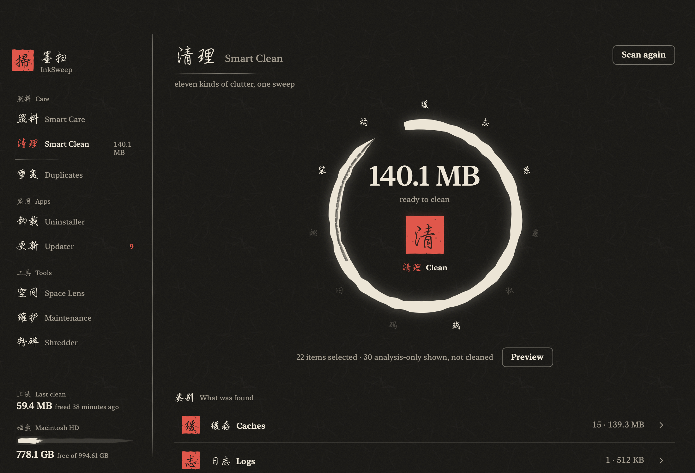

# InkSweep 墨扫

A disk cleaner for macOS, drawn in ink — a sibling of [InkBar](https://github.com/amoswzw/InkBar)
and [InkStats](https://github.com/amoswzw/InkStats). It sweeps the clutter a Mac
collects — caches, logs, app leftovers, duplicates, installers, build artifacts,
large old files — and it is built around one rule: **you see exactly what a clean
will do before you press the seal, and everything goes to the Trash.**

Eight tools, one ink world:

- **Smart Care** — the hub: today's junk, updates, disk and last clean at a glance,
  one daily background scan if you want it.
- **Smart Clean** — eleven categories of clutter, each item listed with size,
  reason and the rule that found it; opt-in categories start deselected.
- **Duplicates** — byte-identical files (size → prefix hash → full SHA-256),
  the oldest copy kept, wasted bytes accounted.
- **Uninstaller** — removes an app *and everything it left*: containers,
  preferences, caches, saved state, login agents — the plan is shown first,
  protected trees are never touched, system apps are refused.
- **Updater** — checks apps' own update feeds (SUFeedURL appcasts) and the App
  Store; a downloaded update is signature- and Gatekeeper-verified before the old
  version goes to the Trash.
- **Space Lens** — where the disk went, as a sized bubble tree you can walk into.
- **Maintenance** — one-click user-space upkeep: Quick Look refresh, disk verify,
  .DS_Store prevention, quarantine history, unavailable simulators, and more.
- **Shredder** — three-pass overwrite for the files you truly want gone; the only
  irreversible surface, behind an explicit confirmation.

## Screenshots

<p>
<a href="docs/screenshots/1-smart-care.png"></a>
<a href="docs/screenshots/2-smart-clean.png"></a>
</p>
<p>
<a href="docs/screenshots/3-space-lens.png"></a>
<a href="docs/screenshots/4-uninstaller.png"></a>
</p>
<p>
<a href="docs/screenshots/5-updater.png"></a>
<a href="docs/screenshots/6-dark.png"></a>
</p>

There is also a menu bar companion (a brushed broom, 掃) with the state of the
last scan, Clean-to-Trash, updates and disk — <a href="docs/screenshots/7-menu-bar.png">screenshot</a>.

## Install

```sh
brew install --cask amoswzw/tap/inksweep
```

Or download the zip from [Releases](https://github.com/amoswzw/InkSweep/releases), unzip it, and move
InkSweep.app to Applications. Releases are signed with Developer ID and notarized by Apple.

## Requirements

- macOS 14 or later. Developed on Apple silicon; Intel Macs are untested.
- Full Disk Access is **optional** — without it InkSweep still scans most
  categories and says plainly what it could not read (Trash, Safari data, Mail).

## How a clean works

1. **Scan** — every category lists its findings with the size on disk, a plain
   reason, and the rule (with provenance) that produced it.
2. **Review** — uncheck anything; analysis-only findings (universal binaries,
   language files, root-owned locations) are shown but never cleaned.
3. **Clean** — items move to the Trash. Emptying the Trash and the Shredder are
   the only irreversible actions, each behind a named confirmation.
4. **Receipt** — what was reclaimed, what failed, nothing hidden.

The safety net behind that flow:

- A curated protection list keeps Apple namespaces, password managers, EDR
  agents and stateful "cache" names (Deno, Playwright, …) out of findings, with
  a reason per entry.
- Running apps and their bundles are detected and skipped (process names and
  bundle IDs).
- Sizes are allocated sizes (APFS), verified against `du`; hard links are never
  double-counted.
- `lipo` waste and language files are measured exactly (fat-header parsing, not
  estimates) and only thinned through a verified APFS clone that must pass
  `codesign --verify --deep --strict` before it replaces anything.

## The CLI

The app bundles a `inksweep` CLI (used by Smart Care's daily scan, and handy on
its own — find it in `InkSweep.app/Contents/Resources/inksweep` after
installing, or `.build/release/inksweep` after building):

```
inksweep scan [--list|--json] [--output <file>]   # scan, print or export
inksweep clean [--category <id>] [--apply]        # preview by default; --apply to act
inksweep apps                                     # installed apps with sizes
inksweep uninstall --bundle-id <id> [--apply]     # full uninstall plan
inksweep duplicates [--min-size-mb N] [--json]    # duplicate groups
inksweep thin [--apply]                           # universal-binary thinning plan
inksweep updates                                  # check app update feeds
inksweep shred [--apply] <path>…                  # 3-pass overwrite
```

## Build

```sh
./Scripts/make-app.sh      # build/InkSweep.app, signed with your Developer ID if one is in the keychain
swift test
```

Development flags: `-InkSweepTool <smartCare|smartClean|uninstaller|duplicates|spaceLens|maintenance|shredder|updater>`
opens on a given tool, `-InkSweepAppearance light|dark` pins the theme, and
`-InkSweepShot <png> [-InkSweepShotDelay s] [-InkSweepShotPanel 1]` renders the
window (or the menu bar panel) to a PNG and quits — that is how the README
screenshots are produced.

## Layout

```
Sources/InkSweepCore/     the engine: models, rules + provenance, scanners,
                          uninstall planner, thinner, updater, shredder, cleaner
Sources/inksweep/         the CLI
Sources/InkSweepApp/      the SwiftUI app (ink design, tools, menu bar panel)
Tests/InkSweepCoreTests/  fixture-based tests, one regression test per
                          false-positive class found on real machines
```

MIT License — see [LICENSE](LICENSE) and [THIRD_PARTY_NOTICES.md](THIRD_PARTY_NOTICES.md).
